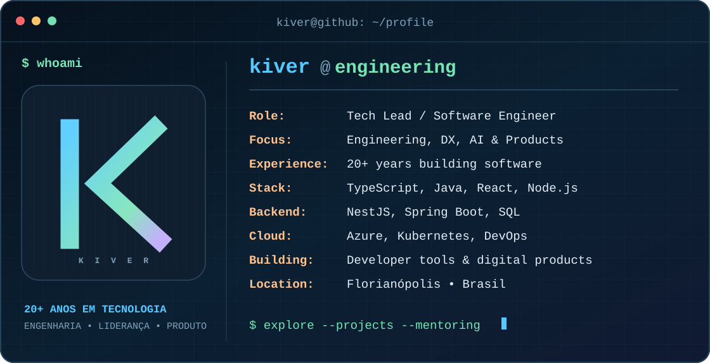

<!-- Perfil público de Kiver Teixeira · github.com/kivervinicius -->

<picture>
  <source media="(max-width: 680px)" srcset="./assets/terminal-mobile.svg">
  
</picture>

<h1 align="center">Kiver Teixeira</h1>

  <strong>Mais de duas décadas construindo software, liderando pessoas e aprendendo com tecnologia.</strong>

  <a href="https://kiver.dev">Site pessoal</a> ·
  <a href="https://www.linkedin.com/in/kiverteixeira/">LinkedIn</a> ·
  <a href="https://github.com/kivervinicius?tab=repositories">Repositórios</a>

## Sobre mim

Sou engenheiro de software e líder técnico, com experiência em arquitetura de sistemas, engenharia de produtos digitais e desenvolvimento de equipes. Priorizo a experiência de quem usa o software e a sustentabilidade de quem precisa mantê-lo.

Meu trabalho combina **Software Engineering**, **Engineering Leadership**, **Developer Experience**, **AI Engineering** e **Product Engineering**. Também valorizo a mentoria e a troca de conhecimento.

## Tecnologias e práticas

- **Aplicações:** TypeScript, Node.js, React, NestJS, Java e Spring Boot.
- **Dados e infraestrutura:** PostgreSQL, SQL Server, Azure, Kubernetes e CI/CD.
- **Engenharia:** arquitetura de software, qualidade, automação, experiência de desenvolvimento e IA aplicada.

## Projetos em destaque

- **[Orquestrador Maestro](https://github.com/IAPro-Community/Orquestrador-Maestro)** — iniciativa open source para orquestrar ferramentas e agentes de IA, com skills, fluxos de trabalho e práticas de engenharia.
- **[Aprincar](https://github.com/aprincar/platform)** — plataforma aberta de aprendizagem por meio de jogos, com arquitetura local-first.
- **[Aprincar — jogos oficiais](https://github.com/aprincar/games-official)** — desenvolvimento e manutenção de experiências educacionais do ecossistema Aprincar.

## Vamos conversar?

Tenho interesse em **mentoria**, liderança e arquitetura de engenharia, colaboração em produtos e conversas técnicas. Entre em contato pelo [LinkedIn](https://www.linkedin.com/in/kiverteixeira/) ou conheça mais em [kiver.dev](https://kiver.dev).
