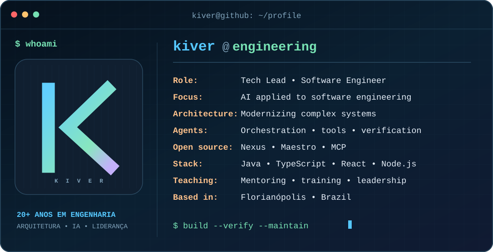

<!-- Perfil público de Kiver Teixeira · github.com/kivervinicius -->

<picture>
  <source media="(max-width: 680px)" srcset="./assets/terminal-mobile.svg">
  
</picture>

<h1 align="center">Kiver Teixeira</h1>

<strong>Engenharia de software · Liderança técnica · IA aplicada</strong>

  <a href="https://kiver.dev">Artigos e projetos</a> ·
  <a href="https://www.linkedin.com/in/kiverteixeira/">LinkedIn</a> ·
  <a href="https://github.com/kivervinicius?tab=repositories">Repositórios</a>

## Quem sou

Sou engenheiro de software e **Tech Lead na Omega Sistemas**, com mais de 20 anos de experiência em desenvolvimento, arquitetura e evolução de produtos. Minha trajetória passa por front-end, back-end, infraestrutura, liderança de equipes e formação de profissionais — incluindo atuação como professor universitário.

Hoje concentro meus esforços em **aplicar IA à engenharia de software**: construir e coordenar agentes, melhorar fluxos de desenvolvimento e modernizar sistemas legados com critérios de qualidade, segurança e manutenção.

A IA pode acelerar a implementação. **Arquitetura, revisão, contexto e responsabilidade pela entrega continuam sendo trabalho de engenharia.**

## No que trabalho

- **Arquitetura e modernização:** evolução gradual de sistemas, compatibilidade, integração e redução de risco em legados.
- **AI Engineering e agentes:** orquestração, ferramentas de desenvolvimento, automação supervisionada, verificação e evidências.
- **Liderança e formação:** decisões técnicas, desenvolvimento de equipes, mentoria e transferência de conhecimento.
- **Open source:** ferramentas que transformam experimentos em fluxos utilizáveis e sustentáveis.

## Open source em destaque

| Projeto | Proposta |
| --- | --- |
| **[IAPro Nexus](https://github.com/IAPro-Community/nexus)** | Workstation e control plane para agentes de desenvolvimento, projetos e missões verificáveis. |
| **[Orquestrador Maestro](https://github.com/IAPro-Community/Orquestrador-Maestro)** | Processo reutilizável de contexto, skills, execução e verificação para ferramentas de IA. |
| **[Visual Production MCP](https://github.com/kivervinicius/visual-production-mcp)** | Fluxo assistido para transformar roteiros em personagens, storyboard, mídias e montagem; integrações externas ainda em evolução. |
| **[Aprincar](https://github.com/aprincar/platform)** | Plataforma aberta, local-first, de experiências de aprendizagem por meio de jogos. |

## Base técnica

**Linguagens e aplicações:** Java, Spring Boot, TypeScript, React, Node.js, NestJS, Object Pascal.

**Dados e infraestrutura:** PostgreSQL, SQL Server, Azure, Kubernetes, Docker, CI/CD.

**Práticas:** arquitetura de software, APIs, interoperabilidade, automação, revisão de código, segurança e developer experience.

## Conteúdo e colaboração

Escrevo sobre **engenharia além do código**: adoção responsável de IA, agentes, arquitetura, manutenção e decisões técnicas. Também tenho interesse em colaboração open source, mentoria, assessoria técnica, palestras e treinamentos.

[**Leia em kiver.dev**](https://kiver.dev) · [**Converse comigo no LinkedIn**](https://www.linkedin.com/in/kiverteixeira/)
